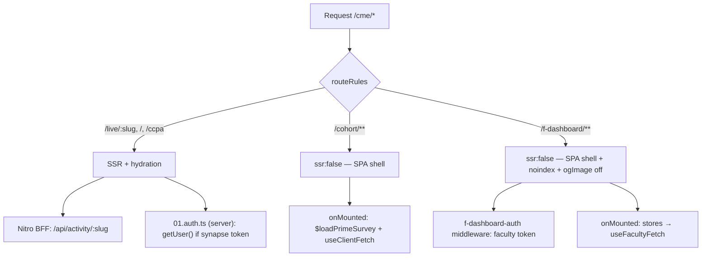
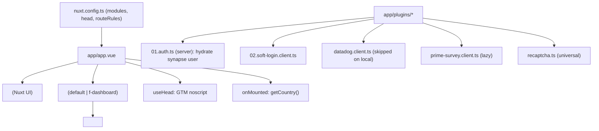
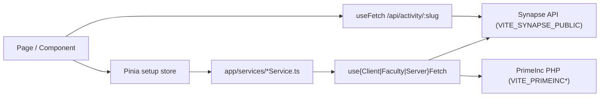

# Architecture

## Overview

Prime Synapse Site is the **public-facing PRIME® CME website**, built with Nuxt 4 (Vue 3) and served under the base path `/cme/`. It is a **universal (SSR) app** with selected client-only areas. It talks to several backends: the Synapse REST API, legacy PrimeInc PHP endpoints, a survey API, and its own small Nitro server acting as a BFF/proxy.

Three distinct experiences live in one app:

1. **Public CME content** (`/live/:slug`, `/`, `/ccpa-privacy-policy`) — SEO-friendly **SSR**.
2. **Cohort surveys** (`/cohort/:surveyHash/:cohortHash`) — **client-only** SPA, `noindex`.
3. **Faculty portal** (`/f-dashboard/**`) — **client-only** SPA, cookie-gated, `noindex`.

## Rendering model



SSR is the default. `nuxt.config.ts` `routeRules` disables SSR for `/cohort/**` and `/f-dashboard/**`. See [rendering-and-routing.md](rendering-and-routing.md).

## Bootstrap / hydration flow



- **`app/app.vue`** wraps everything in `<UApp>`, renders `NuxtLoadingIndicator`, `NuxtLayout`, `NuxtPage`, injects GTM `<noscript>`, and calls `getCountry()` on mount.
- **`app/error.vue`** renders the 404/error page with a debug panel in `local`/`qa`.
- **Plugins** run in numeric/name order. `01.auth.ts` is server-side and hydrates the CME user from the `synapse_user_token` cookie during SSR.

## Data flow



Pages read/mutate Pinia stores; stores call thin service factories; services call one of the three fetch wrappers. The activity landing page instead calls the Nitro BFF (`/api/activity/:slug`) which aggregates several Synapse calls server-side. See [api-layer.md](api-layer.md).

## Directory structure

```
prime-synapse-site/
├── nuxt.config.ts           # Modules, head, routeRules, vite, runtimeConfig
├── app/
│   ├── app.vue              # Root shell (<UApp>, layout, page)
│   ├── error.vue            # Error / 404 page
│   ├── assets/
│   │   ├── prime-icons/     # Custom SVGs for @nuxt/icon (prime-icon:*)
│   │   └── style/           # tailwind.css (v4), main.scss, _variables.scss, tokens
│   ├── components/          # UI/ wrappers + domain folders + global/
│   ├── composables/         # Fetch wrappers, form composables, UX helpers
│   ├── constants/           # Auto-imported constants (imports.dirs)
│   ├── layouts/             # default.vue, f-dashboard.vue
│   ├── middleware/          # Route middleware (auth, guards, global)
│   ├── pages/               # File-based routes
│   ├── plugins/             # client / server / universal plugins
│   ├── services/            # API service factories
│   ├── stores/              # Pinia setup stores
│   └── utils/               # Helpers (cookies, error logger, pdf, masks)
├── server/
│   ├── api/                 # Nitro endpoints (geo, activity BFF)
│   └── plugins/             # Nitro plugins (legacy /nuxt → /cme redirect)
├── shared/types/            # Cross-cutting TS types
├── i18n/locales/            # en.json, es.json + use-translation.ts
├── public/                  # Static assets, status.html health check
├── test/                    # Vitest specs (mirrors app/)
├── stories/                 # Storybook stories
├── docker/                  # Dockerfiles, nginx, entrypoints
├── jenkins/                 # ECS deploy pipelines per env
├── .env.*                   # Per-environment config (local, dev, qa1-3, staging, prod)
├── eslint.config.mjs        # ESLint flat config (+ Prettier)
├── vitest.config.ts         # Vitest (Nuxt env + happy-dom)
└── tsconfig.json            # extends .nuxt/tsconfig.json (strict)
```

## Key architectural decisions

- **Per-route rendering** — SSR by default for SEO; `ssr:false` route rules turn the cohort and faculty areas into client-only SPAs (with `noindex`).
- **Nitro as a BFF** — the activity landing page aggregates Synapse calls server-side (`server/api/activity/[slug].ts`) with production caching, keeping the SSR payload single-request and cacheable.
- **Two independent auth systems** — CME `synapse_user_token` (+ soft-login) and faculty `faculty_portal_token` never mix. See [auth.md](auth.md).
- **Three fetch wrappers, not one** — client, faculty, and SSR wrappers each own their auth/401 behavior. See [api-layer.md](api-layer.md).
- **Setup stores everywhere** — all Pinia stores use `defineStore(id, () => …)`.
- **Thin services** — services map DTOs and call a wrapper; stores own loading/error/PDF-expiry state.
- **Tailwind v4 + `@nuxt/ui`** — utility-first styling with a wrapper component layer (`app/components/UI/`) over Nuxt UI primitives, plus SCSS for the faculty design system.
- **`runtimeConfig.public`** — all env access goes through `useRuntimeConfig()`, never `process.env` in app code.
